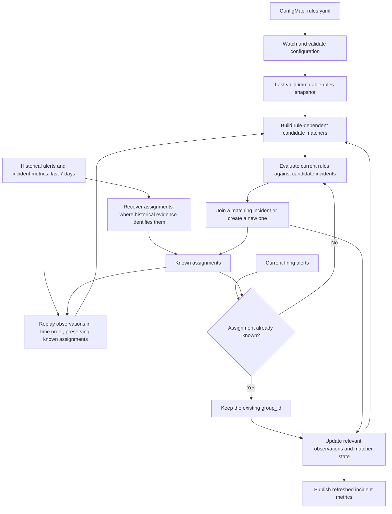
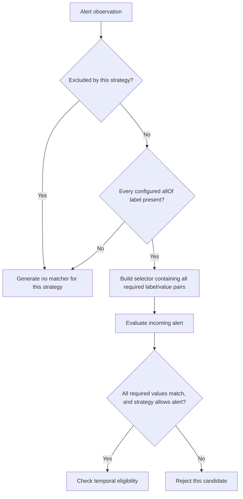
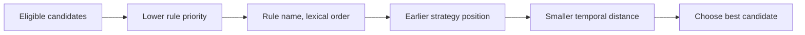
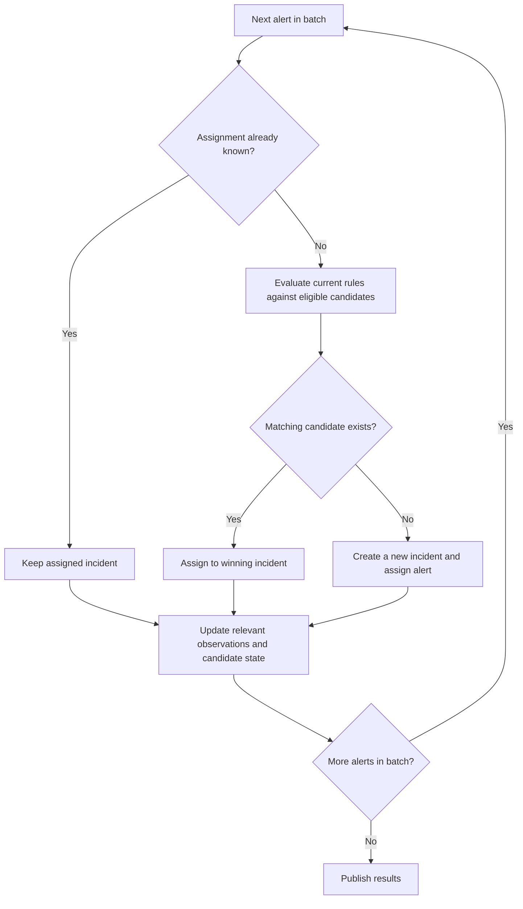
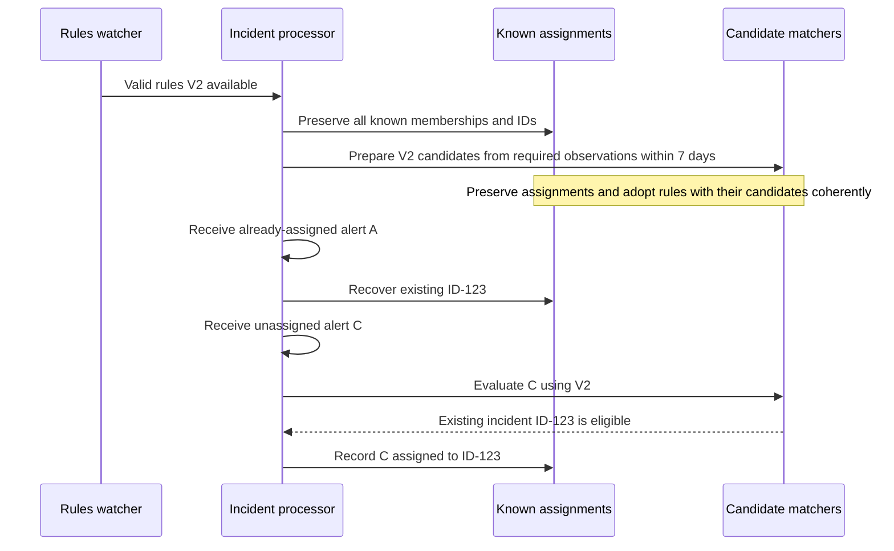
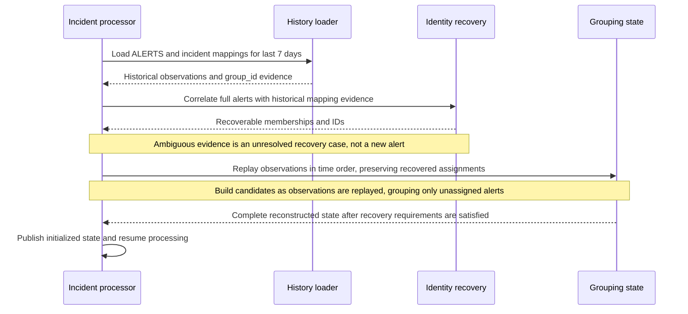
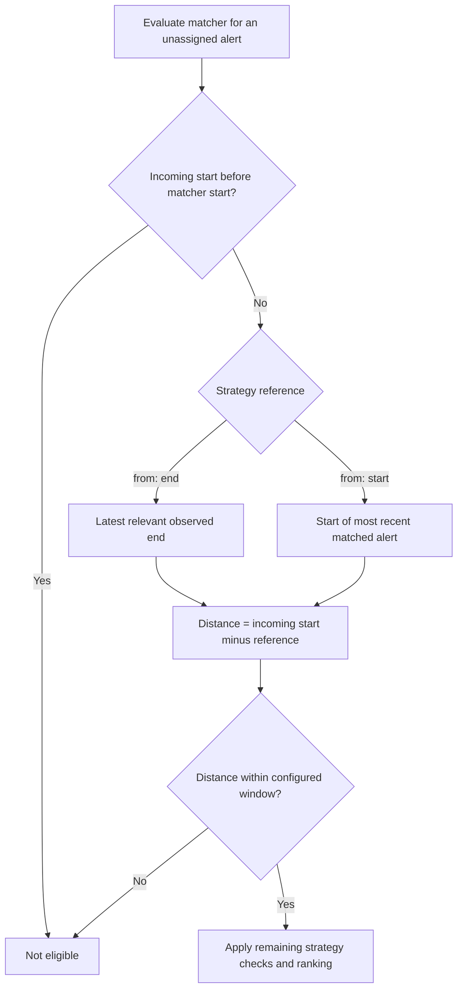
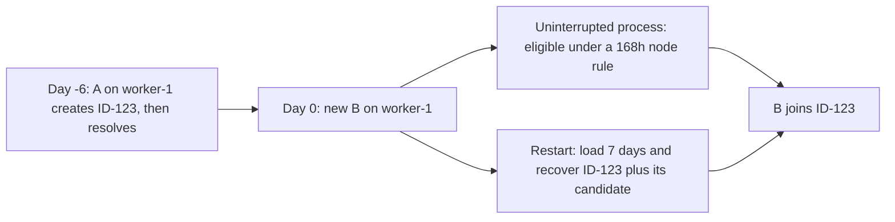
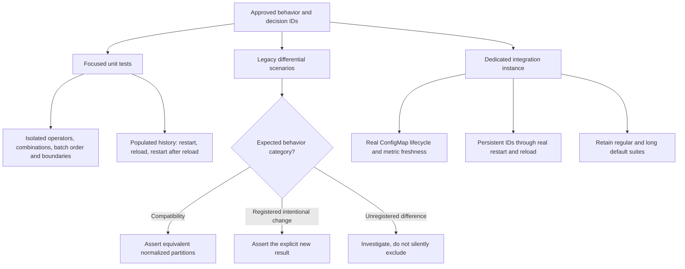
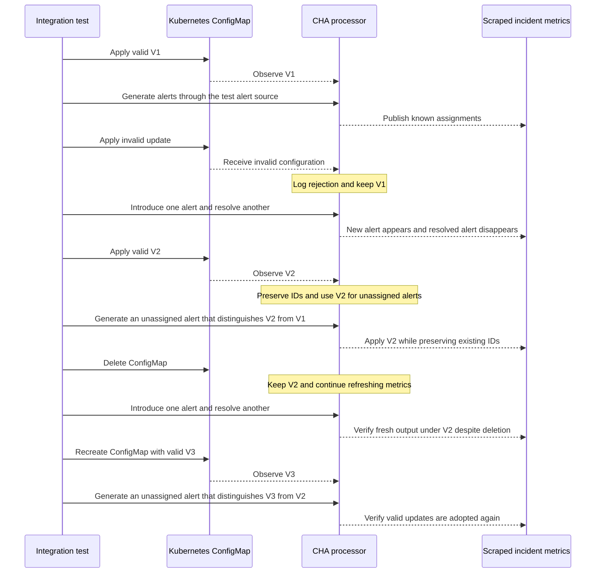

# Incident rules via ConfigMap

This is the consolidated reference for ConfigMap-based incident grouping: the
configuration format, current implementation, approved design changes, diagrams,
compatibility decisions and verification plan. It supersedes
`RULES_IMPLEMENTATION_PLAN.md` and `docs/custom-rules.md`.

## Status and scope

The feature was introduced in `eacf3dc` and reviewed against `eacf3dc^` at checkout
`fa3b247`. In this document, **current** refers to that reviewed implementation;
**target** refers to the approved requirements.

**Implementation status:** D1, D2, D4, D5, D6 and D7 are implemented with unit
tests; D3 is partially implemented (live reload preserves assignments and
regenerates candidates; restart-time identity evidence remains an open design
item). Verification is unit-level plus lint; cluster lifecycle and long
integration scenarios have not been rerun. A latent label-aliasing defect in
exact matcher generation, exposed by D2, was also fixed. See the
[intentional-difference register](#intentional-difference-register) for test
references.

Unless marked **current**, diagrams describe the **target design**. Boxes are
logical responsibilities, not new services, packages, databases or public APIs.
Reuse the existing processor, watcher and history loader. Component health, TLS,
authentication and silence evaluation are outside this redesign.

| ID | Current behavior (at review) | Approved target | Status |
|---|---|---|---|
| D1 | Unmatched alerts in one batch can receive one shared root without evaluating rules | Rules always prevail over batching; no precedence switch | Implemented |
| D2 | `allOf` drops missing labels, potentially producing an empty selector | Every listed label is mandatory | Implemented |
| D3 | Reload replays history; ID recovery depends on grouping selectors | Preserve known assignments; recover identity independently of grouping | Partially implemented (live reload) |
| D4 | Invalid updates or deletion can publish empty rules and stop metric refreshes | Keep the last valid configuration at runtime; fail startup without valid rules | Implemented |
| D5 | Pod namespace file, otherwise `default` | Environment override → pod namespace → `default` | Implemented |
| D6 | Positive windows above seven days are accepted | `0 < within <= 168h`, inclusive | Implemented |
| D7 | Four-day history; pruning based on `Modified` | Seven-day history and strategy-aware pruning; no incident lifetime cap | Implemented |

## Contents

- [Configuration format and deployment](#configuration-format-and-deployment)
- [Processing responsibilities](#processing-responsibilities)
- [Namespace selection](#namespace-selection)
- [Validation and configuration lifecycle](#validation-and-configuration-lifecycle)
- [Operators and candidate selection](#operators-and-candidate-selection)
- [Rules prevail over batching](#rules-prevail-over-batching)
- [Non-retroactive rule changes](#non-retroactive-rule-changes)
- [Restart and identity recovery](#restart-and-identity-recovery)
- [Seven-day horizon and pruning](#seven-day-horizon-and-pruning)
- [Verification and compatibility](#verification-and-compatibility)
- [Implementation map and open details](#implementation-map-and-open-details)
- [Branch history and provenance](#branch-history-and-provenance)

## Configuration format and deployment

### Source and schema

Rules are supplied through a standard ConfigMap:

- Name: `cluster-health-analyzer-config`.
- Data key: `rules.yaml`.
- No custom CRD or additional configuration service.

The following is a complete node-only configuration example, using the namespace
of the repository manifests. It replaces the configured strategy list; it is not
an addition to implicit defaults. The D1/D2 fixes are still required for the
reviewed implementation to honor its intended behavior in all cases.

```yaml
apiVersion: v1
kind: ConfigMap
metadata:
  name: cluster-health-analyzer-config
  namespace: openshift-cluster-health-analyzer
data:
  rules.yaml: |
    rules:
      - name: by-node
        priority: 0
        strategies:
          - match:
              allOf: [node]
            within: 24h
            from: start
```

| Field | Meaning |
|---|---|
| `rules` | Nonempty list of rule definitions |
| `name` | Required rule name; used in precedence ordering |
| `priority` | Optional signed 32-bit integer, default `0`; lower values win |
| `strategies` | Nonempty ordered list; earlier strategies within a rule take precedence |
| `match` | Required: one of `exact: true`, `allOf: [keys]`, `anyOf: [keys]`, or `{}` for temporal matching |
| `within` | Positive duration using `h`, `m`, `s`, maximum 32 characters; target maximum `168h` |
| `from` | Required `start` or `end`; selects the strategy's time reference |
| `excludeAlerts` | Optional label selectors; matching alerts are excluded from this strategy, not globally |

Time references belong to an individual matcher, not the whole incident.
Currently, `from: start` uses that matcher's `Modified` value, updated to the
matched interval's start; `from: end` uses its maximum observed `End`. These are
not necessarily an alert's original firing time: live batches use the processing
timestamp as both interval start and end. Creating a matcher initializes both
references from its observation.

The current schema rejects `excludeAlerts` on a temporal strategy. Each exclusion
selector requires all of its label/value pairs to match; matching any selector
excludes the alert from that strategy.

`LoadRulesFile`, used by simulation and tests, accepts either a full ConfigMap
manifest or the bare `rules.yaml` payload. This does not provide an automatic
server fallback when a ConfigMap is absent.

### Manifests and RBAC

- [Default rules](../manifests/backend/09_incident_rule_defaults.yaml): the shipped
  ConfigMap and default strategy order.
- [Configuration RBAC](../manifests/backend/10_incident_rule_rbac.yaml): `get`,
  `list`, `watch` on ConfigMaps with
  `resourceNames: [cluster-health-analyzer-config]`. The watcher restricts its
  list/watch using the ConfigMap name field selector.
- The draft `08_incident_rule_crd.yaml` is no longer part of the ConfigMap design.

Kubernetes stores the ConfigMap but does not validate the embedded incident-rule
schema. CHA validates the payload. This avoids CRD installation and lifecycle
management, but makes correct startup and invalid-update handling essential.

Production is managed by cluster-observability-operator (COO) in
`openshift-cluster-observability-operator`. Verify that COO creates the ConfigMap
in the selected namespace and grants the actual CHA ServiceAccount access.
Do not assume COO uses repository manifests unchanged. A production failure has
not been demonstrated.

## Processing responsibilities



Keep two responsibilities separate:

- **Identity:** which incident an already-assigned alert belongs to.
- **Grouping:** whether an unassigned alert can join an incident under current
  rules, or needs a new incident.

Complete labels and historical membership provide identity evidence even when
custom rules retain only a node selector or no label selectors. Do not add hidden
exact grouping strategies to recover identity. Establish the existing identity
semantics for repeated observations, replay and label changes before choosing the
implementation; do not silently introduce a different alert-identity definition.

## Namespace selection

**Target, D5:**

Proposed environment variable: `INCIDENT_RULES_NAMESPACE`; finalize its name
before implementation. The precedence is confirmed. Pod discovery reads
`/var/run/secrets/kubernetes.io/serviceaccount/namespace`.

**Current:** only pod-file discovery and the `default` fallback exist. The
kubeconfig context's namespace is not used. Pod and ConfigMap in the same namespace
already fit automatic discovery; the override supports local execution and
explicit operator configuration. Do not hardcode the COO namespace as the only
supported location.

## Validation and configuration lifecycle

Validate the complete candidate configuration before publication. Do not activate
only the valid subset of an invalid configuration.

Preserve required-name/strategy checks, unknown-field rejection, supported
operators, unique nonempty label-key lists, valid exclusion selectors, supported
`from` values, and positive duration syntax. Add the D6 upper bound of `168h`.
Write seven days as `168h`, not unsupported `7d`.

### Startup

1. Start incident processing.
2. Select namespace and initialize the watcher.
3. Synchronize the initial ConfigMap state.
4. If synchronization fails or the full config is invalid, fail startup with an error.
5. Otherwise, publish the initial valid snapshot.
6. Recover assignments and candidates from 7 days of history.
7. If initialization fails, fail startup with an error.
8. Otherwise, begin live processing.

When incident processing is enabled, missing or invalid initial rules must fail
startup; there is no silent built-in fallback. `--disable-incidents` bypasses this
watcher and processor initialization. Initialization errors must not publish
partially reconstructed state.

### Runtime

1. Process with valid snapshot V1.
2. A ConfigMap event arrives.
3. If the ConfigMap or required key is missing, log the problem, retain V1, and continue processing.
4. Otherwise, if the whole candidate config is invalid, log the problem, retain V1, and continue processing.
5. Otherwise, if the definitions are unchanged, keep the snapshot and matcher state.
6. Otherwise, publish valid snapshot V2.
7. Adopt new rules without rewriting assignments.
8. Continue processing; new assignments use V2.

**Target, D4:** invalid YAML, missing keys, excessive windows and other validation
failures are logged and ignored. Deletion retains the last valid rules; it is not
an implicit disable command. Recreating the ConfigMap must allow updates to resume.
Metadata-only changes must not invalidate matchers.

Failure to prepare candidate state must not expose partial state. Publishing a
snapshot does not itself prove successful processor adoption. Each grouping pass
must use a coherent combination of rules and the candidates built for those rules;
do not mix V2 definitions with V1 matchers. The activation/retry mechanism remains
to be designed and tested. A responding metrics endpoint is insufficient: arrivals
and resolutions must continue updating metrics while invalid updates are ignored.

**Before the fix:** invalid input or deletion could publish an empty snapshot.
Processing then stopped refreshing incident metrics while old values remained
exposed. The implemented watcher keeps the last valid snapshot instead;
startup without any valid snapshot still fails.

## Operators and candidate selection

### Operator semantics

| Operator | Matcher generation and matching contract |
|---|---|
| `exact: true` | Preserve existing full-label selector behavior |
| `allOf: [keys]` | Target: generate a selector only when every named label is present; incoming alerts must satisfy every required label/value |
| `anyOf: [keys]` | Generate alternatives for configured labels present in the observation; one matching alternative is sufficient; no present keys means no matcher |
| `match: {}` | Explicit temporal matching, without label selectors; not an implicit batch fallback |

The current exact implementation uses a full-label **subset selector**, not
symmetric label-set equality: additional incoming labels do not themselves
invalidate it. No change to that behavior was agreed.

Exclusions apply to both matcher generation and incoming-alert evaluation for the
specific strategy. Another configured strategy can still legitimately match.

### Mandatory `allOf` labels — D2



An observation missing `node` must not reduce `allOf: [namespace, node]` to a
namespace-only matcher, or turn `allOf: [node]` into an empty match-all selector.
An empty value is distinct from an absent label; no nonempty-value requirement was
introduced. Test individual strategies in isolation so fallback cannot mask errors.

### Ranking eligible candidates

Preserve the branch's ordering, from most to least significant:



Eligibility includes labels, exclusions, window checks and rejection of candidates
whose start is later than the incoming interval's start. End-anchored overlapping
intervals may have negative temporal distance; do not introduce a nonnegative
requirement.

Current selection uses a stable sort. Equal-ranked candidates retain their input
order, but matcher generation may involve map iteration. This is not a guaranteed
global tie policy; investigate ambiguous ties rather than inventing a new one.

### Default strategy order

| Order | Strategy | Window | Reference |
|---|---|---|---|
| 1 | Full-label exact selector | `24h` | End |
| 2 | `allOf: [namespace, alertname, service, job, container]` | `24h` | Sliding start |
| 3 | `anyOf: [alertname, namespace]` | `24h` | Sliding start |
| 4 | Explicit temporal strategy | `15m` | Sliding start |
| 5 | Full-label exact fallback | `120h` | End |

The fuzzy strategy excludes `Watchdog` and
`AlertmanagerReceiversNotConfigured` in `openshift-monitoring`. Within one rule,
exact strategies with the same `from` and exclusion definitions share the timeline
created for an observation, so the exact fallback sees updated ends. Preserve this
behavior when rebuilding candidates; there is no general timeline sharing across
all strategies or rules.

Strict `allOf` changes default behavior for alerts lacking one of its listed
labels. Record that intentional difference; do not hide a legacy partial-label
exception under the same operator name.

## Rules prevail over batching

**Target, D1:**



Candidates created within a batch must be available to subsequent unassigned
alerts. Batch membership alone never justifies grouping.

With only `allOf: [node]` and no existing matches:

| Inputs in one batch | Required result |
|---|---|
| A on worker-1, B on worker-2 | Separate incidents |
| A on worker-1, C on worker-1 | One incident |

Reverse inputs and repeat in separate batches at the same evaluation time for
these simple cases. Compare partitions, not random UUIDs. This does not imply
that arbitrary complex rule sets are globally order-independent.

No batching-precedence option will be added. Explicit temporal rules may still
group nearby alerts. Preserve and test Watchdog safeguards: current code suppresses
new temporal root matchers for the entire unmatched batch containing
`Watchdog` in `openshift-monitoring`, not just for Watchdog itself. Watchdog may
still match an existing temporal candidate; this is not a global exclusion.
Removing implicit batching must not accidentally remove these distinctions.

## Non-retroactive rule changes

**Target, D3:**



“New” means **not yet assigned**, not simply first observed after an update.

Example, initially grouped by namespace, with observations inside the window:

| Alert | Namespace | Node | Before update | After node-only rules |
|---|---|---|---|---|
| A | production | worker-1 | ID-123 | ID-123 |
| B | production | worker-2 | ID-123 | ID-123 |
| New C | production | worker-1 | Unassigned | May join ID-123 |
| New D | production | worker-3 | Unassigned | New incident if no candidate matches |

Existing incidents may accept new members under current rules. Do not split
ID-123 into node-specific incidents or merge existing identities retroactively.

A new strategy may need labels or older observations that V1's matchers discarded.
For example, replacing a one-hour rule with a seven-day node rule may require
observations no longer represented by the old candidates. Retain or reload the
necessary evidence within the seven-day horizon without reassigning existing
members. Rebuilding only from reduced V1 selectors is not sufficient in general.

**Before the fix:** rule changes called `InitGroupsCollection`, replaying history
under the new rules. The implemented `adoptRules` replaces that path: it rebuilds
candidate matchers from currently assigned firing alerts without rewriting any
historical membership.

## Restart and identity recovery

**Target, D3/D7:**



Use complete historical `ALERTS` labels and intervals to correlate observations
with the available incident-mapping evidence, rather than using grouping selectors
as identity. A node-only selector cannot satisfy a historical selector that also
requires alert name, namespace and severity; a temporal matcher has no selector.

### Recovery evidence is currently lossy

`cluster_health_components_map` does **not** retain every original alert label.
`getLabelsSubset` exports namespace, alert name, severity and component-specific
matching keys; labels such as `node` may be omitted. `UpdateGroupUUIDs` currently
uses these exported `src_*` labels and interval overlap to find a previous ID.

For example, two simultaneous alerts with the same unmapped alert name, namespace
and severity, but different nodes, can belong to different incidents under a
node-only rule. Their mapping series can differ only by `group_id`. Full `ALERTS`
series still distinguish the nodes, but the mappings do not identify which ID
belongs to which node. A first-match lookup cannot prove the original assignment.

The assumption that historical data is available does not resolve this loss of
identity information. Establish sufficient identity evidence and add a collision
test before claiming reliable recovery. The exact evidence format and any metric
changes are unresolved; do not silently treat an ambiguous prior assignment as
unassigned, pick an arbitrary ID, or add a new store as part of this documentation.
The existing loader is the intended starting point, not proof that its current
payload can satisfy every recovery case.

Replay candidate observations in time order. Do not prepopulate matchers with
later, disjoint observations before processing earlier unassigned alerts, as that
can change eligibility and precedence. This does not prohibit legitimate interval
overlap or negative end-anchored distance.

The decisive test is a restart **after a rule change**: A and B above must retain
ID-123 even though current rules applied from scratch would separate them.
Recover known assignments before grouping remaining unassigned observations.

Assume required history is available. Recovery without necessary historical data
is outside the agreed guarantee. Loader/initialization failures must not publish
partial state.

## Seven-day horizon and pruning

**Target, D6/D7:**

| Concept | Contract |
|---|---|
| Matching window | `0 < within <= 168h`, inclusive upper bound |
| Historical query horizon | Last seven days at startup or required reconstruction |
| Incident lifetime | Not capped at seven days |



`from: start` preserves the matcher-specific sliding reference, not incident
creation time. Exact-boundary matches remain eligible. Keep the future-start
rejection and end-overlap behavior described above.

Preserving an alert's assigned ID does not mean refreshing every matcher attached
to that incident. Currently, an exact match updates its shared exact timeline but
does not automatically renew temporal or fuzzy windows. Define and test equivalent
observation updates for the new identity path; otherwise a continuously firing
assigned alert could keep an unrelated temporal candidate alive indefinitely.

### Recovery example



The current four-day query omits available data for A. Seven-day loading fixes the
query horizon, but does not replace identity recovery. An incident created ten
days ago may retain its ID and accept new alerts based on recent observations.

Pruning must not remove a still-eligible end-anchored matcher solely because
`Modified` is old. Retaining bookkeeping must not extend matches beyond `within`.
Review retention with shared exact-strategy timelines; the requirement is an
eligibility invariant, not an already-verified replacement pruning formula.

## Verification and compatibility



### Required coverage

| Area | Minimum scenarios |
|---|---|
| Strategies | Complete/missing labels, exclusions, isolated behavior and legitimate fallback |
| Batches | Same/different nodes, reversed order, within-batch candidates, Watchdog present/absent |
| Identity | Populated history with default, node-only and temporal-only rules; restart after rule change; different-node alerts with identical exported source labels; chronological replay |
| Runtime configuration | Valid → invalid → valid → deleted → recreated; metadata-only no-op; coherent rule/candidate adoption on failure or rapid successive updates |
| Startup | Missing/invalid configuration fails; loader errors do not publish partial state |
| Namespace | Override, pod-file and `default` fallback; actual COO packaging/RBAC |
| Time | Before/at/after boundaries, maximum accepted/rejected windows, pruning interleavings; assigned exact re-observations must not implicitly renew other strategies |
| History | Available data between four and seven days old; older incidents with recent observations; longer windows or new label keys requiring evidence discarded by old matchers |
| Differential | Independent names/namespaces, competing candidates, missing labels, empty batches and order variations |

### Configuration lifecycle in a real cluster



Alert-generation arrows represent the real Prometheus test source, not a new
injection API. Check metric freshness, not only readiness or HTTP success.
Use a dedicated backend and restore test resources/configuration on success or
failure; never mutate production or a concurrently shared CHA instance.

Keep regular smoke/TLS/crashloop integration tests and the five long scenarios:
temporal grouping, namespace/name fuzzy matching, exact replay and severity-change
subset matching. These cover default behavior, not every custom configuration,
reload or multi-day boundary. Unit tests can advance time without waiting days.

### Intentional-difference register

The following test names are **proposed**, not evidence of implementation.
The baseline is the reviewed branch unless explicitly identified as inherited
legacy behavior.

| ID | Concrete previous behavior | Required outcome | Test reference | Status |
|---|---|---|---|---|
| D1 | Different-node alerts in one batch are implicitly grouped | Node-only rules separate them | `TestRulesOverrideInitialBatchGrouping` | Implemented |
| D2 | Missing node reduces `allOf` to a namespace selector | Generate no matcher for that strategy | `TestAllOfRequiresEveryLabel` | Implemented |
| D3 | History replay, reduced selectors and lossy exported identity labels can prevent reliable ID recovery | Preserve assignments across update/restart; new alerts may join existing incidents; distinguish colliding historical mappings | `TestProcessorReloadsMatchersOnRuleChange` (live reload); restart recovery open | Partially implemented |
| D4 | Invalid/deleted configuration stalls updates | Keep last valid rules and fresh metrics; fail invalid startup | `TestRulesWatcherRebuildInvalidatesChangedDefinitions`, `TestRulesWatcherObservesUpdatesAndDeletion`; lifecycle integration pending | Implemented (unit level) |
| D5 | No explicit namespace override | Environment → pod namespace → `default` | `TestRulesNamespacePrecedence` | Implemented |
| D6 | Windows above seven days accepted | Reject `within > 168h` | `TestRuleWindowMaximum` | Implemented |
| D7 | Four-day loading and old `Modified` can lose eligible candidates | Seven-day loading and eligibility-aware pruning | `TestPruningRespectsStrategyReference`, `TestMatcherRetentionUsesStrategyReference` | Implemented |

The corresponding design sections explain each rationale. Keep concrete scenarios,
old/new expectations, actual test locations and verification status in the register,
synchronized with the session coverage report. Investigate unregistered differences
rather than adding broad exclusions to legacy comparisons.

D1/D2 deliberately change inherited behavior; D7 addresses inherited limitations.
Do not reintroduce them merely to satisfy blanket legacy equality. Compare
normalized incident partitions for compatible cases, and explicitly assert the
new result for approved differences.

### Commands and evidence

```sh
# Focused packages, then the repository's race-enabled unit suite and linter.
go test ./pkg/processor ./pkg/server
make test
make lint

# Compile integration packages without contacting a cluster.
go test ./test/integration/... -run '^$'
```

Run regular, long and new lifecycle/restart integration scenarios only against an
explicitly selected dedicated cluster; see the [integration README](../test/integration/README.md).
Report actual results and skipped checks. Passing existing tests is not proof that
the planned fixes have been implemented or that every regression is excluded.

## Implementation map and open details

| Responsibility | Existing code to change or verify |
|---|---|
| Validation, operator generation, shared timelines | [rules.go](../pkg/processor/rules.go) |
| Namespace, watch events, last-valid snapshot | [rules_watcher.go](../pkg/processor/rules_watcher.go) |
| Batching, selection, pruning, historical UUID handling | [incidents.go](../pkg/processor/incidents.go) |
| Historical identity evidence and exported source-label projection | [types.go](../pkg/processor/types.go), [alerts.go](../pkg/processor/alerts.go) |
| Reload adoption and historical loading | [processor.go](../pkg/processor/processor.go) |
| Startup history horizon | [server.go](../pkg/server/server.go) |
| Default configuration and RBAC | [defaults](../manifests/backend/09_incident_rule_defaults.yaml), [RBAC](../manifests/backend/10_incident_rule_rbac.yaml); inspect COO packaging separately |
| Verification | [processor tests](../pkg/processor), [integration suite](../test/integration/README.md) |

Resolve these details without changing the approved contract:

- Alert identity representation for repeated observations, replay and label changes,
  including sufficient historical evidence when exported source labels collide.
- Chronological candidate reconstruction and matcher-specific observation updates
  when rules change but assignments remain fixed.
- Coherent adoption of a rules snapshot and its candidates, including preparation
  failures and rapid updates; recovery of evidence absent from old matchers.
- Ambiguous equal-ranked candidates; stable sort alone is not a global policy.
- Final environment variable name and COO deployment/RBAC wiring.
- Retention details preserving eligible shared timelines and bounded matching.

The future of `simulate` is deferred: removal or cluster dependence remains open.
Do not add packaged defaults or simulation options as part of these fixes.
No new dependency, CRD, persistent database or batching-precedence switch is
planned. Historical evidence sufficiency must be established before claiming the
current persistence format can implement all identity guarantees. Retroactive
split/merge identity policies were superseded by the non-retroactivity requirement.

## Branch history and provenance

The original configuration document recorded two development branches based on
`origin/main` in the release-1.1 line. These are historical references, not current
branch-tip claims:

| Branch | Recorded fork point | Recorded tip | Role |
|---|---|---|---|
| `custom-rules` | `774eadb` | `ca4e5ec` | Superseded CRD draft |
| `custom-rules-configmap` | `custom-rules` | `40a61e9` | ConfigMap-based successor |

The CRD draft used `IncidentRule` in `monitoring.openshift.io/v1alpha1`, an OpenAPI
schema with CEL validation, and a dynamic informer. Its default and RBAC manifests
covered the custom resource. The ConfigMap successor removed the CRD installation
and alpha lifecycle burden, switched to a standard ConfigMap informer, and narrowed
configuration RBAC to the named ConfigMap. Validation moved into CHA's parser.

Both designs externalized hardcoded incident heuristics in `pkg/processor`:
labels, precedence and time windows. This document combines that configuration
history with the later `eacf3dc` review and approved changes; historical behavior
must not be mistaken for the target runtime policy.

Related repository documentation:

- [Architecture index](../ARCHITECTURE.md).
- [Health analysis engine](health-analysis-engine.md).
- [Integration test execution](../test/integration/README.md).

Session records in the RedHat Obsidian vault, under `cluster-health-analyzer/`:

- `Custom-Rules-Regression-Review-eacf3dc` — central session hub and original review.
- `Custom-Rules-Must-Fix-Decisions-eacf3dc` — approved requirements and deferred work.
- `Custom-Rules-Coverage-and-Compatibility-Decisions-eacf3dc` — tests, seven-day
  contract and intentional differences.
- `Custom-Rules-Implementation-Plan-eacf3dc` — consolidated implementation sequence.

Update implementation and verification status when changes are actually made.
The diagrams document decisions; they are not executable tests or proof of fixes.
